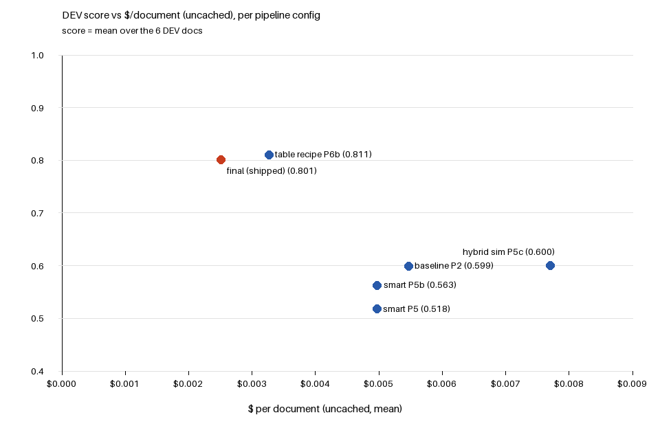

# DESIGN

## Problem

Turn a business document (PDF, scanned PDF, DOCX, XLSX or CSV) plus a field list the service
may never have seen into the fixed result format, with a citation and a confidence per value.
Hard gates: `docker compose up` + `/health`, and at least 80 % of documents VALID within 30
minutes with 10 in flight. A null answer scores better than a wrong one or a timeout.

## Architecture

```
client --POST /jobs--> api (FastAPI) --one transaction: job + file + event--> Postgres 17
                                                                                 |
         worker x2 (default) <--claim: FOR UPDATE SKIP LOCKED, lease 60 s, fence--+
           read document -> document map (text / cells / page images)
           -> model call(s) via LLM_BASE_URL -> code checks the JSON -> result row (terminal)
client --GET /jobs/{id}--> api --> result once terminal
```

One Python 3.12 image, three roles: **api**, **worker**, and **Postgres 17** as both the
database and the job queue. No Redis: `FOR UPDATE SKIP LOCKED` gives a correct queue with one
less moving part, and the job, its file and its event log commit in the same transaction.
Uploaded files are stored in a Postgres table and deleted once the job is terminal, so there
is no shared volume between api and worker.

## Key decisions with evidence (decision · why · number)

**Queue and crash safety**

| Decision | Why | Evidence |
|---|---|---|
| Claim with SKIP LOCKED + 60 s lease + 15 s heartbeat + fence token | a dead or frozen worker must not lose or duplicate a job | chaos run: SIGKILL'd worker's job re-claimed (fence 2) and finished once, 85 s after the kill; a paused worker's late write rejected (`logs/P1_chaos.txt`). P8a L2: re-claimed and terminal once, 66.4 s after the kill (see Load) |
| 2 worker replicas by default (W-1) | the scaling run doubled throughput from 1 to 2 workers | P8a L3: 11.3 → 23.4 → 30.7 jobs/min for 1/2/3 workers (`eval/load.jsonl`); graders can still `--scale` |
| Terminal statuses enforced in the DB (compare-and-set + trigger + one terminal event per job) | the contract says terminal never changes; code bugs should not be able to break that | trigger and unique-index tests |
| Deadline 1500 s from submission → `PARTIAL` with an all-null result | the harness gives 1800 s; a null answer beats a timeout (zero) | sweeper runs every 5 s in its own thread |
| A job claimed more than 3 times → `PARTIAL` all-null (poison job) | one bad document must not loop forever or block a worker | crash-loop and repeated-error tests |
| `PARTIAL` reason in `result.metadata.terminal_reason`; `error` only for `FAILED` | keeps `error` meaningful | |
| `429` + `Retry-After: 30` at 500 pending; `413` above 50 MB | back-pressure the harness understands | |
| `/health` 200 only if the DB answers `SELECT 1` within 1 s | "up" should mean "can accept jobs" | DB stopped → 503 in about 1.1 s |
| File type accepted if extension **or** content says PDF/DOCX/XLSX/CSV | refusing a supported file fails the document; a wrong extension should not | |
| Field list validated loosely (non-empty `fields` object) | unfamiliar field lists must work | |
| Logs carry job id, status, timings only | documents may be confidential | |
| Base images pinned tag@digest, multi-arch, no `platform:` | same build on the grader's machine (amd64 or arm64) | fresh clone: cold build 18 s, `up` → `/health` 200 in 5.6 s (P8a cold check: see `logs/P8a_report.md`) |

**Extraction: the baseline path (shipped)**

| Decision | Why | Evidence |
|---|---|---|
| Baseline: readers (text with page/cell addresses; scanned pages as JPEG) + one Haiku 5.5 call with all fields, code checks the JSON, null over guess | a cheap, honest floor to measure every later change against | DEV mean 0.599 (n = 6): single-value docs 0.70–1.00, big tables 0.05–0.11 (the model returns 6 of 119 and 36 of 325 rows); ≈ $0.0055/doc uncached (`logs/P2_eval.md`) |
| Proper readers, one document map (P3): XLSX/CSV rows with cell refs, merged/hidden/formula flags; DOCX XML walker (numbering, accepted tracked changes, text boxes, tables); PDF word → line → block model with callouts, header/footer tags and scan triage | the extractor should see the document's structure and exact addresses, not a flat dump | DEV mean 0.579 vs 0.599 (n = 6): om_001 0.948 vs 0.966, rentroll 0.006 vs 0.110 (P2's two rent-roll runs already ranged 0.009–0.110), others unchanged; P2 outputs kept (`logs/P3_eval.md`) |
| Models (P4): Haiku 5.5 for text and scans, locate-then-read for page choice, one call for all fields | best score per dollar among the listed models | 5 vision models on the 25-page scanned lease: Haiku locate-then-read 0.825 at $0.0057 vs Gemini 3.8 Flash 0.825 at $0.127. Field groups cost 2.3× for ±0.025. Noise spread 0.017 on om_001 and 0.025 on lease_002 (n = 4 each), so ≤ 0.025 counts as noise (`logs/P4_report.md`) |
| Haiku with `reasoning: {effort: none}` | its default is medium effort, billed as output | same score (1.000) on the pilot doc, 0 vs 3,964 reasoning tokens, $0.0095 vs $0.0108 |
| DOCX page numbers: pluggable method, default `none` (P3-27); LibreOffice not added (A-12) | DOCX has no pages; a wrong page is worse than none | the `estimate` method placed 0/20 locatable lease_002 citations on the exact page (13/20 within ±1); a slim LibreOffice image gave 23 pages and 0/20; the fuller-font build gave 20/20 but +474 MB, so it was not added |

**Cost guards**

| Decision | Why | Evidence |
|---|---|---|
| Per-document $ fuse, predicted before every call (P2-36) | the old cap only looked at money already spent, so one call could overshoot it 1.3× | input estimated high (1.5 chars/token, 2,600 tokens per image, +15%), whole call priced at the cliff rate when the estimate reaches it; trim the input, else skip → PARTIAL `doc_llm_cap`. Rent-roll re-run: estimate 79,469 vs real 57,118 tokens (1.39× high), $0.0097, fuse not needed |
| Input-size estimate calibrated per block type | chars/3.5 undercounted spreadsheet rows ~1.9×, so one rent-roll request sent 114k tokens and paid Haiku's 5× long-prompt price | rows 1.75, prose 2.6 chars/token; the re-run estimated 59,965 and sent 57,118 |
| Dev budget stop and response cache only in `compose.dev.yaml` | a grader's run must never stop on a dev budget or read a dev cache | `tests/test_shipped_config.py` (A-14) |

**The smart path: tested 3 times, not shipped**

- **P5 built:** a "smart" path for single-value field lists, behind
  `EXTRACT_SINGLE_VALUE_PATH` (default `baseline`). The model quotes evidence for each field,
  code checks the quote and normalises the value, and anything unproven becomes null. Scans
  use locate-then-read.
- **Ship rule (written before the paid runs):** switch only if the 3-doc mean of 3-run means
  is ≥ old mean + 0.025, and no doc's mean is more than 0.025 below its old score.
- **P5 numbers:** score = validate.py doc score, 3 live runs per doc, old = P2 outputs.
  lease_001 0.342 vs 0.700, lease_002 0.700 vs 0.775, om_001 0.908 vs 0.966. Mean 0.650 vs the
  0.8385 bar, so the default stays `baseline`. The main cause was that scan answers whose page
  reference could not be matched were nulled (`loc_unknown`: 25 of 40 lease_001 fields in
  run 1). $0.0446 for 10 doc-runs (`logs/P5_report.md`).
- **P5b checker fix:** the checker now compares meaning, not spelling: a page named in any
  form (must be a sent page), free text taken from the source span it found, list items checked
  one by one, numbers and dates parsed (the quoted number wins). Same ship rule.
- **P5b numbers:** 3 new live runs per doc, same definition. lease_001 0.593 (P5 0.342,
  old 0.700), lease_002 0.708 (0.700, 0.775), om_001 0.920 (0.908, 0.966). Mean 0.740 vs the
  0.8385 bar, so the default stays `baseline`. `loc_unknown` is now 0 in every run. 0
  hallucinations, $0.0403 for 9 doc-runs (`logs/P5b_report.md`).

**Long tables: the table recipe (shipped, P6–P8b)**

| Decision | Why | Evidence |
|---|---|---|
| For a long table, the model sees a preview and writes a small recipe (header row, column → field map, document-level cells); code runs it over every row. A heuristic recipe is built too; the one with more checks passed and more rows filled wins (`EXTRACT_TABLE_PATH=spec`) | one call can't return 325 rows (the baseline returned 2–36 of them); a recipe costs one call whatever the length | P6b, 3 live runs: rentroll_001 0.9298 / 0.9886 / 0.9298 (baseline 0.006–0.110), t12_001 0.5485 every run (baseline 0.046), boxscore_001 0.95 / 0.95 / 0.88; ≈ $0.001/doc (`logs/P6b_report.md`) |
| Ship rule judged against a **live** floor | the box score's "old 1.000" came from a cache replay; live, the old one-call path was cut off at the 8,192-token output cap with 1 of 10 rows | old path, 3 live runs: 0.100 each (P6 and P8b runs 21–23, flag `truncated_output`). Recipe 3-run mean 0.950 ≥ 0.100 − 0.025, so tables ship (`logs/P8b_part1_report.md`) |
| `parse` on recipe cells (date range / date / number from a cell's text) and a merge guard (a merged document field must normalise to its type) | header cells like a week or period range hold the only date | works on invented sheets (tests); **no live gain on DEV**: the box-score `date` and t12 period fields stay null |
| Recipe prompt keeps the P6b wording (Z-17b) | the P8b wording that explained `parse` coincided with a t12 drop to 0.1571 (n = 1) vs 0.5485 in 5 of 5 runs on the P6b wording | sum of the two table docs' means: P6b wording 1.4635 vs P8b wording ≤ 1.3680 (best case). A planned 0.925 box bar sat inside the measured 0.88–0.95 spread (planning error, stated in the report) |
| Scan page choice (`SCAN_PAGE_METHOD=locate`) **not shipped** | P4's spike suggested picking pages beats sending the first 8 | lease_001, 3 live runs: 0.850 / 0.825 / 0.250, mean 0.642 vs bar 0.675 + 0.025 = 0.700 (old path live 0.650 / 0.700). Unstable, so the default stays `first` |

**Confidence (P5-17, placeholder until calibrated):** a hand rule over how each value was
verified, not the model's own number. Exact quote with the value in it 0.90 · fuzzy quote 0.75 ·
computed from verified parts 0.80 · read from a page image 0.70 · null 0.60; the model saying
"low" −0.15; a lease expiration that disagrees with commencement + term −0.20; clipped to
[0.05, 0.95]. Not yet measured against accuracy.

## Evaluation method

Sample set split (D03): 6 development documents, 2 held out (one lease, and the only document
using the budget field list, to simulate an unseen field list). Prompts and rules are tuned on
the 6 only; the held-out 2 were run and scored once, inside the sealed final run, and nothing
was changed after seeing them. Score = `tools/validate.py` `score()`
(strict match after normalisation); n is stated with every number; a difference of ≤ 0.025 is
noise (P4). Cost is counted as max(reported, computed), because one gateway reported $0.

**Known contamination (disclosed):** before the split was made, the planning chat read every
answer file while exploring the sample set, including the two held-out answers. Since the
split, no prompt, rule or description is tuned on them, the coding agent is blocked from
opening them (deny rules + a hook, verified in `logs/P1_lockcheck.md`), and the evaluation
script leaves them out until the final run. The held-out score is therefore close to, but not
strictly, an unseen-data score.

## Results

<!-- AUTO:results -->
| Document | Set | Path | Score |
|---|---|---|---|
| boxscore_001 | DEV | table:heuristic | 0.880 |
| lease_001 | DEV | baseline | 0.650 |
| lease_002 | DEV | baseline | 0.775 |
| om_001 | DEV | baseline | 0.966 |
| t12_001 | DEV | table:ai | 0.548 |
| rentroll_001 | DEV | table:ai | 0.989 |
| budget_001 | held-out, scored once | baseline | 0.013 |
| lease_003 | held-out, scored once | baseline | 0.600 |

**DEV mean 0.801 (n = 6 documents, 1 run)** · held-out (n = 2, scored once): budget_001 0.013, lease_003 0.600 · all VALID: yes · all calls live: yes · $0.00250/document uncached (mean over the 8 documents) · run `c62ed30` run 90, 2026-11-08

The sealed final run (P8b): all 8 sample documents, once, on the shipped settings (`EXTRACT_TABLE_PATH=spec`, `SCAN_PAGE_METHOD=first`, single-value path `baseline`), response cache off; these are the files in `outputs/`. Score = `tools/validate.py` `score()`: a document's mean of per-field means (strict match after normalisation). Held-out documents were run and scored once, inside this run; nothing was changed after. n = 1 run per document; run-to-run spread from earlier repeats is in DESIGN (Where it fails). Source: the `final: true` line in `eval/history.jsonl`.
<!-- /AUTO:results -->

## Cost vs accuracy



<!-- AUTO:chart -->
| Config | DEV score (6-doc) | $/doc uncached | DEV docs measured | Runs |
|---|---|---|---|---|
| baseline P2 | 0.599 | $0.00547 | 6 | 1 |
| smart P5 | 0.518 | $0.00497 | 3 | 3 |
| smart P5b | 0.563 | $0.00497 | 3 | 3 |
| hybrid sim P5c | 0.600 | $0.00771 | 3 | 3 |
| table recipe P6b | 0.811 | $0.00327 | 3 | 3 |
| final (shipped) | 0.801 | $0.00250 | 6 | 1 |

Each point is a 6-document DEV mean: a config measured on fewer DEV documents is completed with the P2 baseline's score (and $) for the others. Hybrid sim = an offline re-score of the P5b runs (`logs/P5c_hybrid_sim.md`); its $ is both calls. The final point's $ is the sealed run's mean over all 8 documents. Held-out documents are not in the chart. Source: `scripts/plot_cost_accuracy.py`.
<!-- /AUTO:chart -->

The table recipe is what moved the score: it lifted the two long tables with one small call
per table, so it also lowered $/doc. The smart path scored lower than the baseline at a
similar cost; the hybrid matched the baseline's score at a higher cost (two calls).

## Cost

<!-- AUTO:cost -->
Final run: **$0.00250 per document** (uncached, mean over 8 documents), $0.02004 for the whole run. Total spend of the 34 eval runs in `eval/history.jsonl`: $0.3003 (cost as the gateway billed it; spikes and pilots outside the eval script are in the phase reports). Uncached = a cached answer priced at the call that filled the cache, as a grader's run has no cache.
<!-- /AUTO:cost -->

All model spend by phase (from the phase reports):

| Phase | Spend |
|---|---|
| P1 skeleton | $0 (no model calls) |
| P2 baseline (pilot ×2 + DEV eval) | $0.098 (9 paid calls; one call crossed Haiku's 100k price cliff: $0.064) |
| P2 rent-roll re-run (P2-35) | $0.0097 (1 paid call; plus 1 boxscore re-submit answered from the dev cache, $0) |
| P3 readers (DEV re-run, om_001 debug call, om_001 re-run) | $0.0198 (6 paid calls) |
| P4 measurements (pilot + 4 spikes; max(reported, computed)) | $0.267 (45 paid calls) |
| P5 smart path (10 doc-runs) | $0.0446 (`logs/P5_report.md`) |
| P5b checker fix (9 doc-runs, 21 calls) | $0.0403 (`logs/P5b_report.md`) |
| P8a load, cold check, zip, docs | $0 (fake model only) |
| P6 table recipe (10 calls) | $0.013947 (`logs/P6_report.md`) |
| P6b table recipe fixes (9 calls) | $0.009597 (`logs/P6b_report.md`) |
| P8b live floors, re-tests, Z-17 (S1) | $0.04349 (`logs/P8b_part1_report.md`) |
| P8b sealed final run (8 docs) | $0.020041 (`logs/P8b_report.md`) |
| **Running total** | **$0.567116** (`logs/P8b_report.md`) |

## Load

<!-- AUTO:load -->
| Scenario | Workers | n | Terminal % | VALID % | p50 s | p95 s | max s | jobs/min | Lost | Dup | POST max s | 5xx | Pass |
|---|---|---|---|---|---|---|---|---|---|---|---|---|---|
| L1 | 1 | 20 | 100.0 | 100.0 | 59.17 | 71.47 | 75.34 | 8.51 | 0 | 0 | 0.64 | 0 | PASS |
| L2 | 2 | 10 | 100.0 | 100.0 | 13.44 | 53.74 | 77.55 | 7.74 | 0 | 0 | 0.234 | 0 | PASS |
| L3 | 1 | 20 | 100.0 | 100.0 | 52.98 | 65.22 | 65.45 | 11.29 | 0 | 0 | 0.235 | 0 | PASS |
| L3 | 2 | 20 | 100.0 | 100.0 | 23.59 | 28.74 | 30.66 | 23.39 | 0 | 0 | 0.218 | 0 | PASS |
| L3 | 3 | 20 | 100.0 | 100.0 | 16.63 | 24.65 | 24.75 | 30.65 | 0 | 0 | 0.282 | 0 | PASS |
| L4 (small) | 1 | 20 | 100.0 | 100.0 | 46.11 | 55.3 | 55.36 | 12.46 | 0 | 0 | 0.235 | 0 | PASS |

L2: a worker holding a lease was SIGKILLed; its job was claimed 2 times, ended SUCCESS with 1 terminal event(s), 66.44 s after the kill.

Throwaway stack with a fake LLM (seeded 1-6 s latency, ~8 % 429 with Retry-After), so times measure the queue and service, not real model latency. Time = submit to first poll that sees a terminal status (client clock, polls every 2 s). VALID = JobStatus shape + the frozen contract check. Lost/dup from the DB event log and a re-GET of every job. Source: `eval/load.jsonl`, latest line per scenario + workers (`scripts/load_test.py`). Code: 6f2da24-dirty, c62ed30-dirty.
<!-- /AUTO:load -->

These runs (P8a, fake model) are the evidence for the 2-worker default: throughput rose from
1 to 2 and 3 workers, no job was lost or duplicated, and a SIGKILLed worker's job finished
once after the lease ran out (`logs/P8a_load_report.md`). L1 was re-run on the final code
(P8b, same fake model; `logs/P8b_load_tables.md`).

## Where it fails

Numbers below are from live runs; n is given each time.

- **Held-out budget (unseen field list): 0.013, scored once.** The run recorded path
  `baseline` (one call) and 1 of 55 rows. INFERENCE: PDF table on the old path (recipes
  cover spreadsheets only). Its per-field detail was not opened. No change was made after
  seeing the score (Z-8).
- **Held-out lease: 0.600, scored once** (DEV leases in the same run: 0.650 and 0.775). Same
  shipped path as the DEV leases.
- **Smart path: tested 3 times, not shipped.** Ship bar 0.8385 (old 3-doc mean + 0.025):
  P5 0.650, P5b 0.740 (3 live runs per doc each), and the P5c hybrid simulation 0.8155. What
  remains is mostly the model returning null (10–12 fields per lease) and short text or dates
  not inside their quote (`logs/P5b_report.md`, `logs/P5c_hybrid_sim.md`).
- **Scanned leases see only the first pages** on the shipped path (8 of 25 pages for
  lease_001). Picking pages first was unstable (0.850 / 0.825 / 0.250, n = 3) and not shipped.
- **Table header dates:** the box-score `date` is null in every live run on the shipped
  prompt (n = 5: P6b 11–13, P8b 36, final) and the t12 period fields are null; the `parse`
  feature showed no live gain. On the shipped prompt the box score is 0.95 or 0.88 run to
  run (n = 5: 0.95, 0.95, 0.88, 0.88, 0.88); in the final run `property_name` and `date`
  are missed in all 10 rows and two percentage fields are wrong in 2 rows each.
- **PDF and long tables on the old one-call path** get cut off at the output cap (box score
  1 of 10 rows, flag `truncated_output`, 3 of 3 live runs). The flag fires; the
  repetition-loop flag did not (threshold 10 %).
- **Measure live:** a cached replay once stood in for a live score (box score "1.000" vs
  0.100 live). Every ship decision since uses `--expect-live` runs with the cache off.
- **A value can pass the quote check and still be wrong:** the checker proves the value is
  in the quoted text, not that the model quoted the right passage. In the offline hybrid
  simulation (P5c, 3 runs per doc), 4 fields took a checked smart value that scored below the
  baseline's correct value, because the quote existed but was the wrong span
  (`logs/P5c_hybrid_sim.md`, per-field table).
- **Stuck parser (PR-65):** no separate parse timeout or killable child process; a hostile
  or huge file holds a worker slot until the job deadline ends it `PARTIAL`. Not seen in load
  runs (max slot time 12.6 s over 110 jobs).
- **Fuzzy list items** keep the model's spelling, not the matched source text.
- **DOCX page numbers:** LibreOffice not added (A-12), so DOCX citations carry no page.
- **Load numbers** use a fake model with 1-6 s replies; real latency is longer and is noted
  separately.

## Next steps

- Recipes for tables outside spreadsheets (the held-out budget took the one-call path and
  returned 1 of 55 rows; cause not verified).
- Record each recipe cell's `parse` in the metadata, so a null header date can be explained.
- Page choice for long scans needs a steadier locator before it can ship.
- A killable parse step (child process with its own timeout) instead of relying on the job
  deadline.
- Calibrate confidence against accuracy (still the hand rule above).
