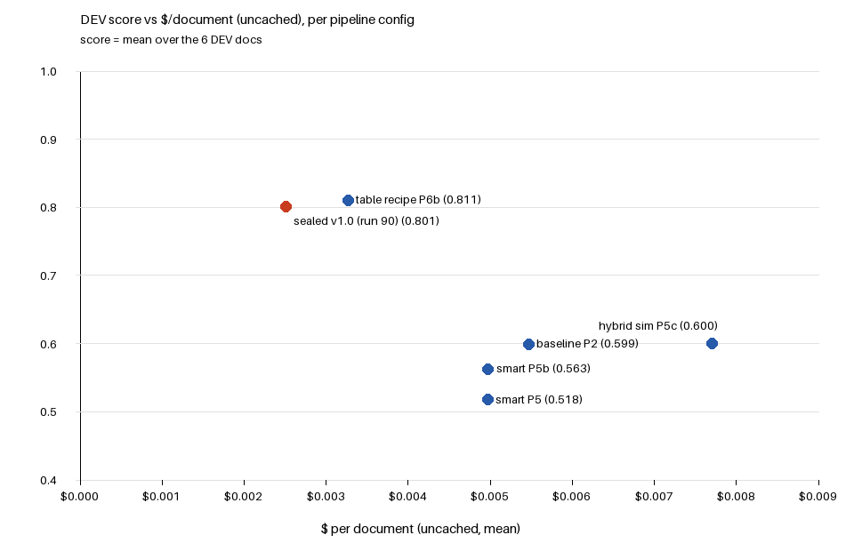

# Outcome DocExtract

Document extraction service for the Outcome take-home.
**Role applied for: AI/ML Developer.**

## What it does

`POST /jobs` takes a document (PDF, DOCX, XLSX or CSV) and a field list (JSON), and returns a
job id at once. A worker reads the document, asks a model for the fields, checks the answer in
code and stores a result in the fixed contract format (`contract/`). `GET /jobs/{job_id}`
returns it once the job is terminal (`SUCCESS`, `PARTIAL` or `FAILED`). Every job ends
terminal with a schema-valid answer, even when a worker crashes or the model is unreachable.
Design and evidence: [DESIGN.md](DESIGN.md).

## How to run

Needs Docker (Compose v2). From the repo root:

```bash
cp .env.example .env        # fill in LLM_BASE_URL and LLM_API_KEY (or export them in the shell)
docker compose up -d --build
curl -s localhost:8080/health          # {"status":"ok",...} once the DB answers
```

The api listens on **port 8080**. All model calls go through `LLM_BASE_URL` / `LLM_API_KEY`.
Without a key the service still starts and every job still ends terminal with a valid answer.

Submit a document and poll it:

```bash
curl -s -F "file=@path/to/doc.pdf" -F "schema=<path/to/field_list.json" localhost:8080/jobs
curl -s localhost:8080/jobs/<job_id>
```

Optional header `X-Organization-Id` scopes a job to a tenant (another tenant gets 404).
Two workers start by default; change it with `docker compose up -d --scale worker=N`.

## Configuration

`compose.yaml` passes only the variables marked "compose"; it has no `env_file`, and the LLM
variables use the `${VAR:-}` form, so an unset variable is empty, never an error. A test
(`tests/test_shipped_config.py`) pins these shipped settings.

| Variable | Default | Set via | Meaning |
|---|---|---|---|
| `LLM_BASE_URL`, `LLM_API_KEY` | empty | compose (worker) | all model calls go through these |
| worker replicas | 2 | compose `deploy.replicas` | `--scale worker=N` overrides it |
| `JOB_DEADLINE_S` | 1500 | compose | after this, a job ends `PARTIAL` with an all-null result |
| `MAX_PENDING` | 500 | compose | `429` + `Retry-After: 30` when this many jobs wait |
| `LEASE_S` / `HEARTBEAT_S` | 60 / 15 | compose | worker lease and heartbeat |
| `SWEEP_EVERY_S` | 5 | compose | how often a worker checks deadlines and dead leases |
| `EXTRACT_TABLE_PATH` | `spec` | compose (worker) | long tables: the model writes a small extraction recipe from a preview and code runs it over every row; `baseline` = one call with the whole table |
| `EXTRACT_SINGLE_VALUE_PATH` | `baseline` | compose (worker) | `smart` turns on the evidence-checked path (measured, not shipped) |
| `SCAN_PAGE_METHOD` | `all` | compose (worker) | single-value field lists on a scanned PDF send every page image (up to 40, each tagged "PAGE n of N") in one call; `first` = v1.0 (first 8 pages); `locate` lets the model pick pages first (measured, not shipped) |
| `PDF_TABLE_METHOD` | `grid` | compose (worker) | table field lists on a text-layer PDF: code builds a line grid and runs the table recipe on it, falling back to the one-call path when the grid fails its checks; `single` = v1.0 |
| `TABLE_CLEANUP` | `1` | compose (worker) | two general cleanup rules on code-copied table rows (placeholder cells → null, "(continued)" dropped from carried section labels); `0` turns it off |
| `E0_ROBUST` | `1` | compose (worker) | robust parsing: per-field salvage of a broken answer, then one fresh call; one more recipe call on low row fill; `0` = v1.0 |
| `SPEC_RETRY_FEEDBACK` | `0` (off) | compose (worker) | P9g: lenient recipe keys + the retry is told what failed. Built and unit-tested, **not live-tested** (the gateway key expired before its gate ran); `1` turns it on |
| `DOCX_PAGE_METHOD` | `none` | compose (worker) | DOCX has no pages; `estimate` guesses them |
| `APP_VERSION` | `dev` | compose | shown by `/health` |
| `LLM_MAX_CONCURRENCY` | 4 | code default | model calls in flight per worker |
| `LLM_MAX_CALLS_PER_DOC` / `LLM_MAX_USD_PER_DOC` | 8 / 0.05 | code default | per-document call and $ fuse |
| `LLM_REQUEST_TIMEOUT_S` | 120 | code default | per HTTP attempt |

Dev-only settings (`DEV_BUDGET_USD`, the response cache) live in `compose.dev.yaml` and are
never part of the shipped stack.

## Scores on the sample set

**v1.1 (shipped code and settings): last full run vs the v1.0 base** (DEV = the 6 development
documents, SYN = 8 invented documents built to cover what DEV lacks):

<!-- AUTO:v11 -->
| Document | Set | v1.0 (n = 2) | v1.1 run 174 (n = 1) | Change |
|---|---|---|---|---|
| boxscore_001 | DEV | 0.915 | 0.950 | +0.035 |
| lease_001 | DEV | 0.637 | 0.825 | +0.188 |
| lease_002 | DEV | 0.750 | 0.775 | +0.025 |
| om_001 | DEV | 0.569 | 0.948 | +0.379 |
| t12_001 | DEV | 0.321 | 0.548 | +0.226 |
| rentroll_001 | DEV | 0.989 | 0.989 | +0.000 |
| syn_lease_text | SYN | 0.863 | 0.875 | +0.012 |
| syn_lease_scan | SYN | 0.150 | 0.925 | +0.775 |
| syn_lease_docx | SYN | 0.900 | 0.900 | +0.000 |
| syn_budget_pdf | SYN | 0.015 | 1.000 | +0.985 |
| syn_rentroll_pdf | SYN | 0.032 | 1.000 | +0.968 |
| syn_rentroll_xlsx | SYN | 1.000 | 1.000 | +0.000 |
| syn_boxscore_csv | SYN | 0.950 | 0.950 | +0.000 |
| syn_loan_unseen | SYN | 1.000 | 1.000 | +0.000 |

DEV (n = 6) 0.697 → **0.839** · SYN (n = 8) 0.614 → **0.956** · DEV+SYN (n = 14) 0.649 → **0.906** · v1.1 all VALID: yes · $0.00217/document · run `662f00a-dirty` run 174, 2026-11-08

v1.1 = the shipped settings (`EXTRACT_TABLE_PATH=spec`, `PDF_TABLE_METHOD=grid`, `TABLE_CLEANUP=1`, `E0_ROBUST=1`, `SCAN_PAGE_METHOD=all`, `SPEC_RETRY_FEEDBACK=0`, single-value path `baseline`). v1.0 base = runs 90, 103, 101, 102 (sealed run 90 + run 103 for DEV, 101 + 102 for SYN; a doc's score is its mean over its 2 runs). SYN = 8 invented documents (`scripts/make_syn.py`). Held-out documents are in neither column. n = 1 for v1.1, so single-doc changes carry run-to-run noise (DESIGN, Where it fails). Source: `eval/history.jsonl` by run index.
<!-- /AUTO:v11 -->

**Sealed v1.0 run 90**: the only run that scored the 2 held-out documents. There is no v1.1
held-out run, because the gateway key expired before one could be made:

<!-- AUTO:scores -->
| Document | Set | Path | Score |
|---|---|---|---|
| boxscore_001 | DEV | table:heuristic | 0.880 |
| lease_001 | DEV | baseline | 0.650 |
| lease_002 | DEV | baseline | 0.775 |
| om_001 | DEV | baseline | 0.966 |
| t12_001 | DEV | table:ai | 0.548 |
| rentroll_001 | DEV | table:ai | 0.989 |
| budget_001 | held-out, scored once | baseline | 0.013 |
| lease_003 | held-out, scored once | baseline | 0.600 |

**DEV mean 0.801 (n = 6 documents, 1 run)** · held-out (n = 2, scored once): budget_001 0.013, lease_003 0.600 · all VALID: yes · all calls live: yes · $0.00250/document uncached (mean over the 8 documents) · run `c62ed30` run 90, 2026-11-08

The sealed **v1.0** final run (P8b): all 8 sample documents, once, on the v1.0 settings (`EXTRACT_TABLE_PATH=spec`, `SCAN_PAGE_METHOD=first`, single-value path `baseline`; no E0, no PDF grid, no table cleanup), no response caching. It is the only run that scored the 2 held-out documents; no v1.1 held-out run exists (the gateway key expired). Score = `tools/validate.py` `score()`: a document's mean of per-field means (strict match after normalisation). Held-out documents were run and scored once, inside this run; nothing was changed after. n = 1 run per document; run-to-run spread from earlier repeats is in DESIGN (Where it fails). Source: the `final: true` line in `eval/history.jsonl`.
<!-- /AUTO:scores -->

Per-field detail of run 90 (field names and counts only): `logs/eval_p8b_final.md`. How each
v1.1 change passed its gate: [DESIGN.md](DESIGN.md#what-changed-in-v11-and-the-gate-each-passed).

### Cost vs accuracy (v1.0 path)



<!-- AUTO:chart -->
| Config | DEV score (6-doc) | $/doc uncached | DEV docs measured | Runs |
|---|---|---|---|---|
| baseline P2 | 0.599 | $0.00547 | 6 | 1 |
| smart P5 | 0.518 | $0.00497 | 3 | 3 |
| smart P5b | 0.563 | $0.00497 | 3 | 3 |
| hybrid sim P5c | 0.600 | $0.00771 | 3 | 3 |
| table recipe P6b | 0.811 | $0.00327 | 3 | 3 |
| sealed v1.0 (run 90) | 0.801 | $0.00250 | 6 | 1 |

Each point is a 6-document DEV mean: a config measured on fewer DEV documents is completed with the P2 baseline's score (and $) for the others. Hybrid sim = an offline re-score of the P5b runs (`logs/P5c_hybrid_sim.md`); its $ is both calls. The sealed v1.0 point's $ is run 90's mean over all 8 documents; v1.1 is in the v11 table (README). Held-out documents are not in the chart. Source: `scripts/plot_cost_accuracy.py`.
<!-- /AUTO:chart -->

## Load results

<!-- AUTO:load -->
| Scenario | Workers | n | Terminal % | VALID % | p50 s | p95 s | max s | jobs/min | Lost | Dup | POST max s | 5xx | Pass |
|---|---|---|---|---|---|---|---|---|---|---|---|---|---|
| L1 | 1 | 20 | 100.0 | 100.0 | 59.17 | 71.47 | 75.34 | 8.51 | 0 | 0 | 0.64 | 0 | PASS |
| L2 | 2 | 10 | 100.0 | 100.0 | 13.44 | 53.74 | 77.55 | 7.74 | 0 | 0 | 0.234 | 0 | PASS |
| L3 | 1 | 20 | 100.0 | 100.0 | 52.98 | 65.22 | 65.45 | 11.29 | 0 | 0 | 0.235 | 0 | PASS |
| L3 | 2 | 20 | 100.0 | 100.0 | 23.59 | 28.74 | 30.66 | 23.39 | 0 | 0 | 0.218 | 0 | PASS |
| L3 | 3 | 20 | 100.0 | 100.0 | 16.63 | 24.65 | 24.75 | 30.65 | 0 | 0 | 0.282 | 0 | PASS |
| L4 (small) | 1 | 20 | 100.0 | 100.0 | 46.11 | 55.3 | 55.36 | 12.46 | 0 | 0 | 0.235 | 0 | PASS |

L2: a worker holding a lease was SIGKILLed; its job was claimed 2 times, ended SUCCESS with 1 terminal event(s), 66.44 s after the kill.

Throwaway stack with a fake LLM (seeded 1-6 s latency, ~8 % 429 with Retry-After), so times measure the queue and service, not real model latency. Time = submit to first poll that sees a terminal status (client clock, polls every 2 s). VALID = JobStatus shape + the frozen contract check. Lost/dup from the DB event log and a re-GET of every job. Source: `eval/load.jsonl`, latest line per scenario + workers (`scripts/load_test.py`). Code: 6f2da24-dirty, c62ed30-dirty.
<!-- /AUTO:load -->

Detail and method: [logs/P8a_load_report.md](logs/P8a_load_report.md).

**These load numbers are v1.0** (P8a/P8b code, fake model). No v1.1 load test was possible,
because the gateway key expired. What v1.1 changes for timing: scanned leases now send every
page, so in live runs 171–173 (n = 3 each) p50 / p95 rose from 13.1 / 16.8 s to 30.0 / 33.2 s
on the 25-page scan and from 9.7 / 10.6 s to 16.2 / 17.8 s on the 15-page scan
(`logs/P9e_report.md`). That is still far inside the 1500 s job deadline.

## Outputs

**outputs/ were produced by the sealed v1.0 run 90. The shipped code is v1.1, measured in
run 174 (DEV+SYN 0.649 → 0.906, 14 documents). Regenerating them with v1.1 was not possible,
because the LLM gateway key expired at the deadline.** Source per file:
[logs/P9f_outputs.md](logs/P9f_outputs.md). All 8 are VALID.

`outputs/<document>.json`: one result per sample document (8 files), each the job's `result`
plus `schema` and `document` keys. They are produced through the running service by
`uv run python scripts/make_outputs.py <doc_id> ...` and checked with
`uv run python tools/validate.py outputs/ --schema-dir sample/schemas` (exit 0 = all valid).
`sample/` (the provided documents and answers) is not in the repository.

## Develop

```bash
uv sync                                   # Python 3.12 env from uv.lock
uv run pytest                             # needs Docker (Postgres testcontainer); no network, no key
uv run ruff check . && uv run ruff format --check .
uv run python scripts/render_docs.py      # refresh the measured blocks in README/DESIGN
uv run python scripts/load_test.py        # load + chaos test on a throwaway stack, fake LLM
uv run python scripts/make_zip.py         # submission zip with safety checks (clean tree)
```

## Known limitations

- **Held-out budget (unseen field list), v1.0: 1 of its 55 rows (score 0.013).** It took the
  one-call path. v1.1's PDF grid sends text-layer PDF tables to the recipe (the 2 SYN PDF
  tables went from 0.030 to 0.986 in its gate), but the held-out budget was never re-run on
  v1.1 (key expired). See DESIGN, Where it fails.
- **Table header dates:** dates that sit only in a header cell (a week or period range) come
  back null on the DEV tables. t12_001 stays at 0.548 in most runs.
- **Scanned PDFs:** v1.1 sends every page, up to 40; a longer scan sends only its first 40.
  Scanned tables keep the v1.0 one-call path.
- **Not finished (gateway key expired at the deadline):** the P9g live test, a v1.1
  held-out run, a v1.1 load test and v1.1 `outputs/`.
- **DOCX page numbers:** none. A DOCX has no pages, and the LibreOffice renderer that could
  place them was not added (image size, start-up time).
- **Smart path and page choice not shipped:** both scored below their ship rule in live runs,
  so they stay behind switches.
- **A stuck parser** (a hostile or huge file) is bounded only by the job deadline, which ends
  the job `PARTIAL`; there is no separate parse timeout.
- **Load numbers use a fake model** (1-6 s replies); real model latency is longer.
- **Held-out set:** the planning chat saw the held-out answers before the split (see DESIGN).

## AI assistance

Built with AI assistance. Every design decision, review and commit is mine. How it was used:

- **Who did what:** Claude (chat) for planning, decision tables and reviewing reports;
  Claude Code for implementation, tests and the measured runs.
- **Workflow:** each phase had a written plan and a decision table that I approved before
  any code. The agent implemented only approved rows, wrote tests first where listed, and
  stopped at fixed points for my review. I wrote every commit.
- **Guard rails:** deny rules and a pre-tool hook kept the agent away from secrets, the
  answer files and the held-out documents. When a guard blocked it, the agent stopped and
  reported instead of finding another route.
- **Corrections caught in review (examples):**
  - P8b: the box-score "old 1.000" that a ship rule leaned on was a cache replay; measured
    live (3 runs) it was 0.100, cut off at the output cap. The bar was re-set from live runs,
    with the formula unchanged.
  - P5: the plan wrote the two-digit-year window two ways ("−50/+49" vs its own example
    "00–76 → 20xx"); the agent flagged it and the example's window was used and tested.
  - P1–P8a: guard false positives (a field key that equals an answer value elsewhere; the
    bare words `cache` / `.env` inside a grep pattern). Each was stopped and reported, never
    worked around; the sample-values guard was then fixed with my approval.
  - P8b: a ship bar set in planning (0.925 on the box score) sat inside that doc's measured
    spread, so it tested noise; I overruled the result and decided on both affected documents.
- **Corrections I made (earlier examples):**
  - P5b: the checker kept the model's number when a quote matched within tolerance; I had it
    output the number the source states instead, and treat an empty list as a null answer.
  - P5b: I narrowed the free-text rule to "the model's value as found inside the source span,
    else the span".
  - P8a: I set the small-machine memory limit to 3 GB to fit the Docker VM, and made 2 workers
    the shipped default after the scaling run.
  - Throughout: drafted commit messages carry no AI trailer; the agent never commits.
